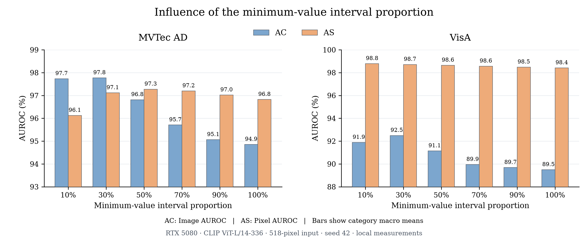
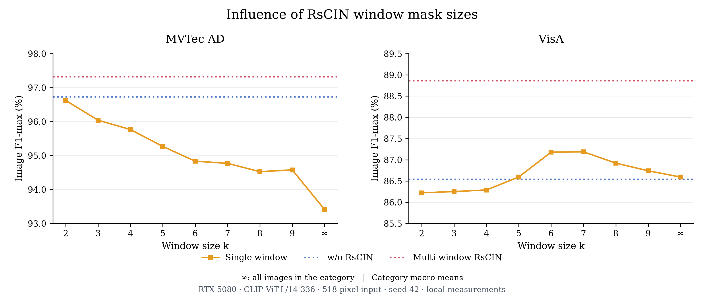

# MuSc Figure 7/8 sweep 자체 실행

## 질문·가설·조건

MSM 하위 minimum-value interval의 상한 비율과 RsCIN single-window 크기가 자체 측정 성능에 미치는 영향을 확인한다. 실행 전 가설은 기준 30% 및 multi-window가 종합적인 절충을 제공하지만 모든 dataset/metric에서 최고가 아닐 수 있다는 것이다.

MVTec15/1,725장, VisA12/2,162장, seed42, 공식 MuSc commit `b76b93da8bd3096a99964a96ae29d46f197a0651`, CLIP ViT-L-14-336/OpenAI, 518입력, batch4, layers0-based=[5,11,17,23], r=[1,3,5], FP16 native autocast, TF32 off, FP64 layer/r 평균을 유지한다. 추가 학습은 없다.

- Figure7 MSM: **0%–10/30/50/70/90/100%** 구간 평균. Table10의 하한2/4/6/8/10%–30% 실험과 다르다. 공식 fast cdist로 각 query의 patch-to-image 최솟값을 한번 계산해 여섯 상한에 공유한다. 각 category/r/layer의 첫 query를 모든 비율에서 공식 compute_scores_fast 및 CPU NumPy와 대조한다. 공식 함수의 topmin_max>=1은 비율이 아닌 개수이므로 100%는 N-1개로 전달한다. k의 floor는 공식 float 비율 연산을 따른다.
- Figure8 RsCIN: single-window **k=2…9, full-window** 및 w/o·native multi-window 기준선. 기존 Table3–7의 같은 raw class tokens·image score를 재사용하므로 backbone 재추론하지 않는다. 모든 window의 smoothing을 CPU NumPy로 독립 대조한다. `full`은 category 이미지 전체의 similarity window이며 `multi`와 다르다. k=1은 단일 sweep 대상이 아니다.

MSM은 새 backbone 특징을 구하고 같은 category 이미지 순서·class feature와 이전 raw 30% patch score를 대조한다. 원본 patch 예측과 선택 query의 patch-to-image 거리 proof를 보존한다. 전체 원본 거리를 보존하는 대신 모든 비율의 예측을 보존해 공간 사용을 제한한다. Image/Pixel AUROC와 image F1/AP를 저장하고, 전체 map을 518 bilinear align_corners=True로 복원해 모든 MSM 지표를 다시 검증한다. RsCIN은 image AUROC/F1/AP를 저장한다. category 평균은 비가중 평균이다. CSV의 지표는 0–1 단위다.

- commit: `b76b93da8bd3096a99964a96ae29d46f197a0651`
- sh: [run_musc_sweeps.sh](../source/run_musc_sweeps.sh)
- state: [environment.json](../source/results/sweeps_seed42_20261012/environment.json)
- result: [결과 폴더](../source/results/sweeps_seed42_20261012/)
- raw: `/home/test/musc_results/sweeps_seed42_20261012`
- log: `/home/test/musc_results/sweeps_seed42_20261012.log`

검증 전 수치를 완료 결과로 취급하지 않는다. IGD는 취소 상태로 유지한다. 모델·raw·기록을 삭제하지 않는다.

## 최종 결과

MVTec15/1,725장 및 VisA12/2,162장의 MSM6비율·RsCIN11조건을 검증했다. 전체 완료. 수치는 0–1 단위이고 dataset 평균은 category별 비가중 평균이다. 논문 수치는 실험 결과로 대입하지 않았다.

- [MSM 비율 평균 CSV](../source/results/sweeps_seed42_20261012/msm_interval_ratio_mean_metrics.csv)
- [RsCIN window 평균 CSV](../source/results/sweeps_seed42_20261012/rscin_single_window_mean_metrics.csv)
- [검증](../source/results/sweeps_seed42_20261012/verification.json)

## Figure 7·8 자체 결과 그림

검증된 평균 CSV를 %로 변환해 원문 구성의 Figure7 AC/AS 그룹 막대와 Figure8 single-window F1-max 곡선·RsCIN 기준선을 작성했다. 숫자·단위·축·범례를 확인하고 PNG/PDF/SVG와 figure별 plot-data CSV를 보존했다. [그림·원시 표·캡션](../source/figures/figures7_8_local/README.md).

