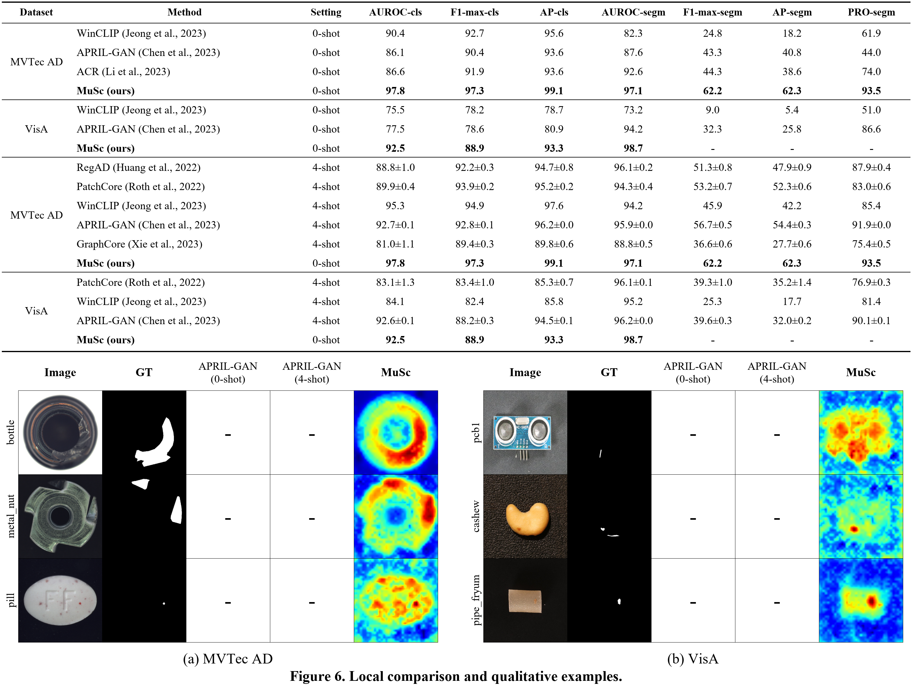

# Figure 6 — 로컬 실행 결과

[PNG](figure6.png) · [SVG](figure6.svg) · [표 데이터](table_data.json) · [시각화 입력·선택 기록](samples.json)

위 표는 [로컬 비교표 Table 1](../../../markdown/MuSc_all_reproduction_tables.md)의 자체 측정값이다. MuSc VisA의 Image AUROC/F1-max/AP 및 Pixel AUROC는 검증 완료된 [Table 3–7 평균 CSV](../../results/tables3_7_seed42_20261012/mean_metrics.csv)에서 추가했다. 아직 집계하지 않은 MuSc VisA Pixel F1-max/AP/AUPRO는 `-`로 표시한다. 단위는 %, ±는 원본에 저장된 반복 표준편차이며 단일 실행에 임의로 붙이지 않았다. 굵은 행은 MuSc다.

아래 이미지는 각 category의 보존 loader 순서상 첫 이상 이미지를 사용한다. MuSc s=1 기본 patch 점수를 FP64 bilinear(518, align_corners=True)로 복원했으며 각 이미지에서 min-max 정규화 후 jet 색상으로 표시했다. GT는 해당 실행 loader의 이진 mask다. 영상별 정규화이므로 색상을 서로 다른 이미지의 절대 점수로 비교하지 않는다. 입력 SHA-256을 확인하고 원본 patch 점수·복원 map·mask를 각 *_figure_data.npz에 보존했다.

APRIL-GAN 0/4-shot의 숫자 결과는 있으나 원시 map과 시각화 파일은 현재 결과 폴더에서 찾지 못했다. 그 두 시각화 열은 `-`로 표시했다. 논문 히트맵을 자체 결과로 재사용하지 않았다. 정확한 논문 샘플 일치를 주장하지 않는다. pcb1은 원문의 pcb 이미지 계열에 해당하는 로컬 category다.

MuSc 근거: [최종 검증](../../results/tables3_7_seed42_20261012/verification.json) · [실행 조건](../../../markdown/MuSc_tables3_7_execution.md).
