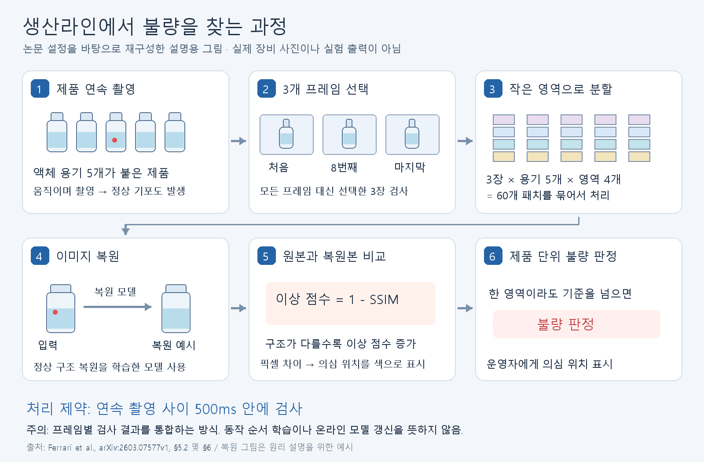
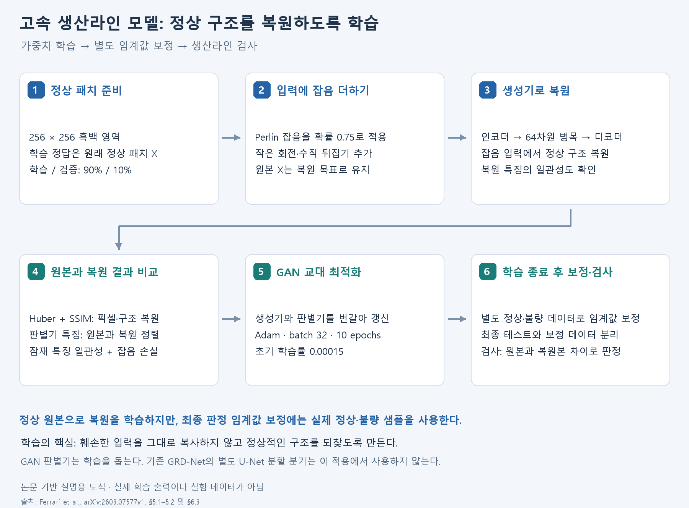
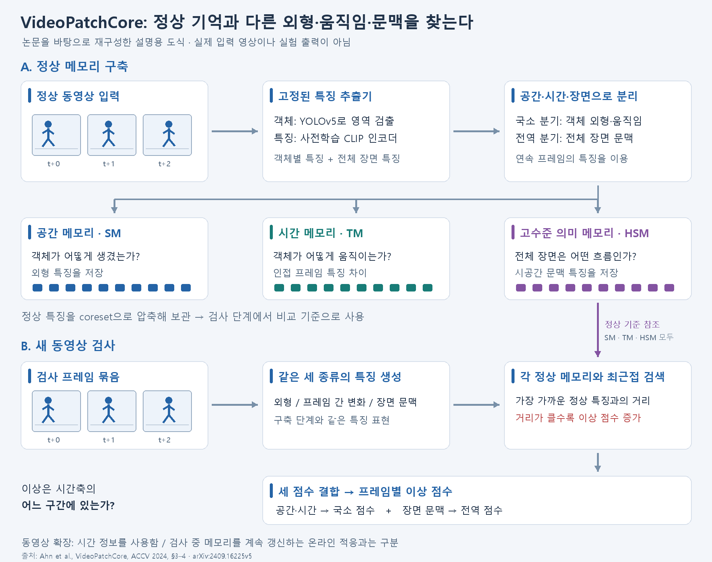
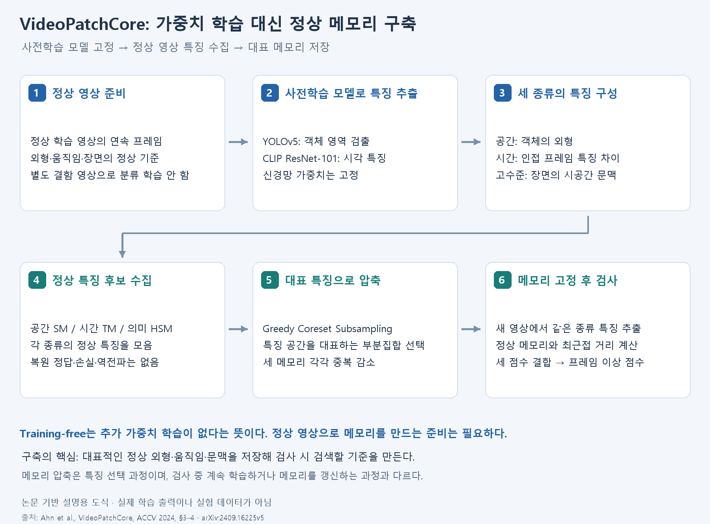

# 연속 촬영 산업 검사와 동영상 이상탐지

## Paper Metadata

| Title | Authors | Conference / Journal | Year | Paper link | GitHub / Official code | Reason for investigation |
|---|---|---|---|---|---|---|
| Integration of deep generative Anomaly Detection algorithm in high-speed industrial line | Niccolò Ferrari, Nicola Zanarini, Michele Fraccaroli, Alice Bizzarri, Evelina Lamma | arXiv preprint; 게재 확정 정보 unverified | 2026 | [원문](https://arxiv.org/html/2603.07577v1) | unverified | 연속 촬영과 실제 생산라인 처리 시간 제약 |
| VideoPatchCore: An Effective Method to Memorize Normality for Video Anomaly Detection | Sunghyun Ahn, Youngwan Jo, Kijung Lee, Sanghyun Park | ACCV | 2024 | [원문](https://arxiv.org/html/2409.16225v5) | [공식 코드](https://github.com/SkiddieAhn/Paper-VideoPatchCore) | 이미지 PatchCore를 움직임·장면 문맥이 있는 동영상으로 확장한 사례 |

## 1. High-speed industrial line: 연속 촬영을 생산라인 판정에 연결

**그림 1.** 논문에 근거해 재구성한 설명용 도식이다. 3개 프레임을 용기 5개·영역 4개로 나눠 총 60개 패치를 검사한다. 빨간 결함과 복원 결과는 원리 설명용 예시이며 실제 실험 출력이 아니다. 500 ms는 촬영 사이 처리 제약을 뜻한다.

### 1.1 무엇이 입력되고 무엇을 판별하는가?

액체가 들어 있는 용기 5개가 연결된 BFS(Blow-Fill-Seal) 제품을 연속 촬영한다. 정상적인 기포·물방울·액체 움직임을 허용하면서 실제 제품 결함을 찾아야 한다. 결과는 패치·용기 수준을 거쳐 제품 단위 불량 판정으로 통합된다.

### 1.2 작동 과정

1. 연속 촬영 시퀀스에서 처음·8번째·마지막 프레임, 총 3장을 선택한다.
2. 각 프레임을 용기 5개와 용기별 영역 4개로 나눈다.
3. 총 3 × 5 × 4 = 60개 패치를 처리한다. 입력은 256 × 256 흑백 패치다.
4. 정상 제품의 재구성을 학습한 인코더·디코더로 입력을 복원한다.
5. 원본과 복원본의 구조 차이를 `1 - SSIM`으로 점수화한다. SSIM은 Structural Similarity Index Measure다.
6. 부분 영역 중 하나라도 불량 기준을 넘으면 제품 불량으로 통합한다.

학습에서는 정상 영상에 Perlin 잡음을 추가해 정상 구조를 복원하도록 한다. GAN(Generative Adversarial Network) 방식의 학습도 사용한다. 최종 임계값 보정에는 별도의 정상·불량 데이터가 사용되므로, 전체 절차에서 실제 결함 정보가 전혀 필요 없다고 설명하면 안 된다.

### 1.3 streaming/online 관점

핵심은 촬영·영역 분할·묶음 처리·제품 판정을 생산 속도에 맞추는 시스템 구성이다. **500 ms는 촬영 사이 처리 요구 시간이지, 그 자체가 측정된 단일 이미지 추론시간은 아니다.** 매 제품마다 가중치나 정상 메모리를 갱신하는 방식으로 설명하지 않는다.

### 1.4 데이터와 평가의 의미

- Bonfiglioli Engineering의 산업 사례와 생산 촬영 조건을 재현한 수집 데이터를 사용한다.
- 학습·검증용 패치는 총 2,815,200개이며 90%/10%로 나눈다. 이는 독립 제품 개수가 아니라 잘라낸 패치 개수다.
- 테스트는 실제 불량 제품을 포함한 산업 검사 키트를 사용한다.
- Table 2의 제품 묶음 정확도(Accuracy)는 95.93%다. AUROC와 다른 지표다.
- 제품을 10회 검사해 7회 이상 맞추면 정분류로 인정하는 별도 반복 검증도 있어, 단일 촬영 결과와 구분해야 한다.
- 공개 다운로드 경로는 unverified이며 공개 표준 벤치마크로 취급하지 않는다.

### 1.5 학습은 어떻게 시키는가?

**학습 도식 A.** 원본 정상 패치를 복원 목표로 유지하고, 입력에만 잡음·증강을 적용한다. 모델 가중치 학습과 최종 판정 임계값 보정은 별도 단계다.

1. **데이터:** 정상 흑백 패치를 학습 90%·검증 10%로 나눈다.
2. **입력:** 확률 0.75로 Perlin 잡음을 더하고 작은 회전·수직 뒤집기를 적용한다. 원본 정상 패치 X가 복원 정답이다.
3. **복원:** 생성기(Generator)의 인코더·64차원 병목·디코더가 복원본을 만들고, 추가 인코더가 잠재 특징 일관성을 확인한다.
4. **손실:** Huber·SSIM으로 픽셀·구조 차이, 판별기 특징으로 적대적 정렬, 잠재 특징으로 일관성을 평가하며 잡음 손실도 사용한다.
5. **갱신:** 생성기와 판별기(Discriminator)를 Adam으로 교대 최적화한다. 배치 32, 10 epochs, 초기 학습률 0.00015다.
6. **보정:** 학습 후 별도 정상·불량 집합으로 판정 임계값을 정한다. 최종 테스트 집합과 분리한다.

핵심은 잡음 입력을 그대로 복사하는 대신 정상 구조를 복원하게 하는 것이다. 별도 U-Net 분할 분기는 사용하지 않는다. 검사에서는 입력과 복원본의 차이를 이용한다.

## 2. VideoPatchCore: PatchCore를 동영상으로 확장

**그림 2.** 논문에 근거해 재구성한 설명용 도식이다. 위쪽은 정상 메모리 구축, 아래쪽은 새 동영상 검사다. 검사 특징은 공간(SM)·시간(TM)·고수준 의미(HSM) 메모리 모두와 각각 비교한다. 사람 그림은 연속 프레임을 나타내는 예시이며 실제 데이터나 예측 출력이 아니다.

### 2.1 기존 기법에서 무엇을 확장했는가?

PatchCore는 정상 이미지의 패치 특징을 메모리 뱅크(Memory Bank)에 저장하고, 검사 패치와 가장 가까운 정상 특징 사이의 거리로 이상을 탐지한다. VideoPatchCore(VPC)는 이 검색 원리와 대표 특징 압축(Coreset Subsampling)을 유지하면서 동영상의 외형·움직임·장면 문맥을 다루도록 확장한다.

### 2.2 동영상에서의 작동 방식

연속 프레임 묶음을 입력받아 고정된 CLIP 시각 인코더로 특징을 추출한다. 객체 단위 국소 분기(Local Stream)와 전체 프레임의 전역 분기(Global Stream)를 사용한다. 정상 동영상에서 다음 세 메모리를 구축한다.

| 메모리 | 처리 정보 | 역할 |
|---|---|---|
| 공간 메모리(Spatial Memory, SM) | 객체 외형 | 정상과 다른 외형 탐지 |
| 시간 메모리(Temporal Memory, TM) | 인접 프레임의 특징 차이 | 비정상 움직임 탐지 |
| 고수준 의미 메모리(High-Level Semantic Memory, HSM) | 시공간 장면 문맥 | 객체 관계·장면 수준 이상 탐지 |

검사에서도 같은 종류의 특징을 만들고 각 정상 메모리와 최근접 거리를 계산한다. 공간·시간 점수는 국소 점수로, 고수준 점수는 전역 점수로 결합해 프레임별 이상 점수를 얻는다.

### 2.3 프레임을 어떻게 묶고 계산하는가?

입력 묶음 크기는 Avenue에서 연속 10프레임, ShanghaiTech·Corridor에서 연속 4프레임이다. 10프레임이 방법 자체의 고정 제한은 아니다. 묶음 안의 각 프레임에서 객체 영역과 전체 장면의 특징을 계산한다.

객체 검출(YOLOv5)은 묶음의 가운데 또는 마지막 프레임에서 수행하고, 검출한 영역을 다른 프레임에도 공유한다. Avenue에서는 가운데 프레임을 사용한다. 따라서 모든 프레임이 특징 계산에 참여하지만, 객체 검출을 매 프레임 독립적으로 반복하는 구성은 아니다.

계산된 프레임 특징을 함께 사용해 외형·프레임 간 변화·장면 문맥을 표현하고 프레임 단위 점수로 평가한다. 입력 묶음 크기와 최종 판정 단위를 혼동하지 않는다. 원본 프레임을 빠짐없이 사용하는지와 묶음 이동 간격(stride)은 이 설명에서 확인하지 않았으므로 단정하지 않는다.

근거: [VideoPatchCore §3.1–3.3, §4.2–4.3](https://arxiv.org/html/2409.16225v5).

### 2.4 사용 데이터와 판별 대상

| 데이터셋 | 영상 구성 | 판별하는 이상 |
|---|---|---|
| CUHK Avenue | 정상 학습 16개·테스트 21개 영상 | 종이 던지기, 달리기, 잘못된 방향 이동 등 |
| ShanghaiTech | 정상 학습 330개·테스트 107개 영상, 13개 장면 | 비정상 물체 등장, 싸움·점프 등 |
| IITB Corridor | 정상 학습 208개·테스트 150개 영상 | 숨기·공놀이 등 비정상 사건 |

평가는 프레임 단위 AUROC(Area Under the Receiver Operating Characteristic Curve)이며, Table 1의 결과는 각각 92.8%, 85.1%, 76.4%다. 산업 제품 결함 전용 데이터는 아니다.

### 2.5 streaming/online 관점과 적용 범위

프레임 하나의 외형만 비교하는 대신 여러 프레임의 변화를 이용하는 동영상 확장이다. 정상 동영상으로 메모리를 구축하며, 검사 중 메모리를 계속 갱신하는 온라인 적응 방법으로 설명하지 않는다. 추가적인 모델 학습 없이 사전학습 인코더를 사용한다는 점과 정상 데이터가 필요 없다는 주장은 다르다.

High-speed industrial line은 연속 촬영을 제품 검사에 통합하는 시스템 사례이고, VideoPatchCore는 특징·메모리 구조에 시간 정보를 추가한 방법론 사례다.

### 2.6 학습 대신 정상 메모리를 어떻게 만드는가?

**학습 도식 B.** 별도 신경망 가중치 학습 없이 정상 특징을 수집·선택한다. Training-free여도 정상 동영상으로 비교 기준을 구축해야 한다.

1. **데이터:** 정상 학습 동영상을 연속 프레임 묶음으로 읽는다.
2. **고정 모델:** 사전학습 YOLOv5로 객체를 검출하고 CLIP ResNet-101로 특징을 추출한다.
3. **특징:** 객체 외형, 인접 프레임 특징 차이, 전체 장면의 시공간 문맥을 구성한다.
4. **저장:** 공간(SM)·시간(TM)·고수준 의미(HSM) 메모리 후보를 모은다.
5. **압축:** Greedy Coreset Subsampling으로 각 메모리의 대표 부분집합을 선택한다. 외형이 중복되는 특징을 모두 저장하는 부담을 줄인다.
6. **검사:** 메모리를 기준으로 새 특징과 최근접 거리를 계산한다. 역전파로 가중치를 갱신하거나 검사 중 계속 적응하는 과정은 아니다.

## 3. 두 논문의 학습·준비 과정 비교

| 항목       | High-speed industrial line | VideoPatchCore        |
| -------- | -------------------------- | --------------------- |
| 정상 기준    | 정상 구조를 복원하는 생성기            | 정상 외형·움직임·문맥 메모리      |
| 준비 데이터   | 정상 제품 패치                   | 정상 동영상                |
| 가중치 학습   | 생성기·판별기 교대 학습              | 추가 학습 없음; 사전학습 모델 고정  |
| 학습 목표    | 원본 복원과 특징 일관성              | 별도 손실·역전파 없이 특징 수집·선택 |
| 실제 결함 정보 | 별도 임계값 보정에 사용              | 정상 메모리 구축에 사용하지 않음    |
| 준비 결과    | 학습된 복원 모델·판정 임계값           | 압축된 세 정상 메모리          |
| 검사       | 원본과 복원 결과 비교               | 검사 특징과 정상 메모리 비교      |
